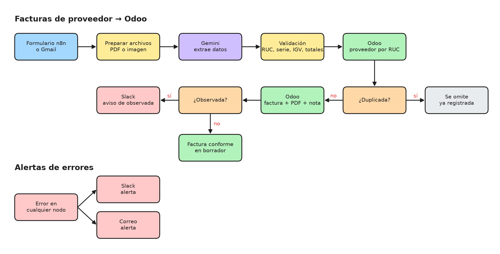
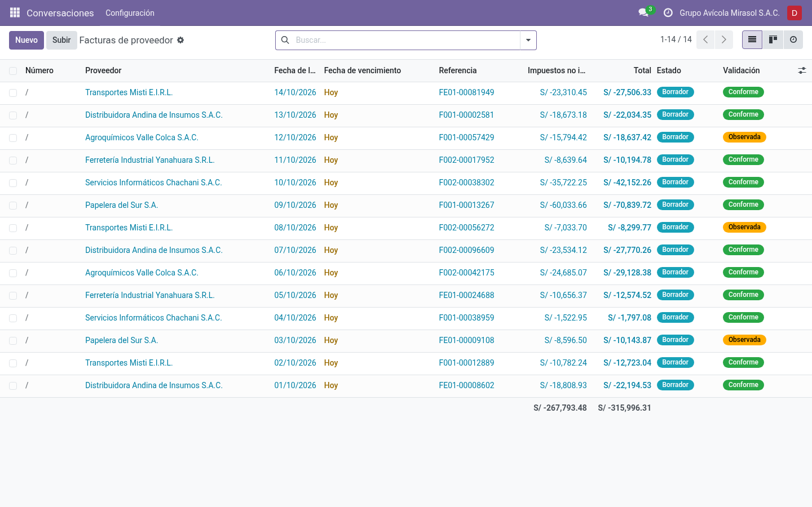
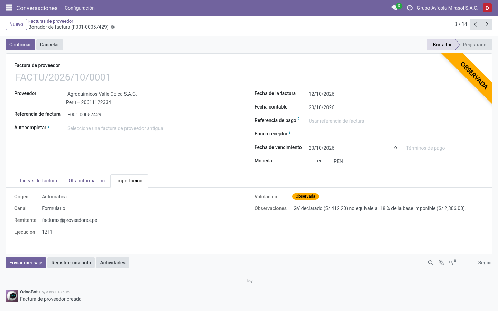

# Facturas de proveedor a Odoo

Registro automático de facturas y boletas de proveedor en Odoo 18 a partir de comprobantes en PDF o imagen. El proceso corre en un flujo de automatización de n8n que usa una API de IA (Google Gemini) para la extracción de datos y registra el resultado en Odoo, de modo que el área contable solo revisa y confirma.



Diagrama editable: [docs/arquitectura.excalidraw](docs/arquitectura.excalidraw), se abre en https://excalidraw.com.

## Qué hace

1. Recibe comprobantes por dos canales: un formulario web de n8n o un buzón de Gmail.
2. Envía el archivo a la API REST de Google Gemini desde un nodo HTTP Request, con un esquema JSON de respuesta, y extrae los datos del comprobante: RUC y razón social del emisor, tipo, serie, número, fechas, moneda, base imponible, IGV, total y detalle de líneas.
3. Valida el comprobante en un nodo Code (JavaScript) según las reglas de SUNAT:
   - RUC de 11 dígitos, prefijo válido y dígito verificador correcto.
   - Serie acorde al tipo de comprobante (F para facturas, B para boletas, E para emisores electrónicos).
   - IGV equivalente al 18 % de la base imponible.
   - Base imponible más IGV igual al total, y suma de líneas igual a la base.
   - Fecha de emisión legible y no futura.
4. Se conecta a Odoo por JSON-RPC sobre HTTP, autenticándose con la clave de API del usuario, busca al proveedor por RUC y lo crea si no existe.
5. Omite el comprobante si ya hay una factura de proveedor con el mismo proveedor y referencia (por ejemplo, `F001-00001234`).
6. Crea la factura de proveedor en borrador con sus líneas e IGV 18 %, adjunta el archivo original y deja una nota en el historial con el resultado de la validación.
7. Marca como observada toda factura que no supere la validación o cuyo total en Odoo no coincida con el del comprobante, y avisa en Slack con el detalle y el enlace a la factura.
8. Ante cualquier error en el proceso, un flujo de alertas envía el detalle por Slack y por correo.

El módulo `facturas_ia` personaliza Contabilidad: las facturas importadas muestran la pestaña Importación (origen, canal, remitente, ejecución, validación y observaciones) y una cinta Observada cuando corresponde. La lista de facturas de proveedor incluye la columna Validación y los filtros Importadas y Observadas.

## Capturas

Facturas registradas en Odoo con datos de ejemplo.





## Requisitos

- Docker y Docker Compose.
- Clave de API de Google Gemini.
- Cuenta de Google con acceso al buzón que recibirá los comprobantes y credenciales OAuth2 de Google Cloud con la API de Gmail habilitada.
- Aplicación de Slack con un token de bot (`xoxb-`) con el permiso `chat:write`, invitada al canal de avisos.

## Instalación

1. Copiar el archivo de variables y completar los valores:

   ```bash
   cp .env.example .env
   ```

   | Variable | Descripción |
   | --- | --- |
   | `TZ` | Zona horaria de n8n |
   | `POSTGRES_PASSWORD` | Contraseña de PostgreSQL |
   | `ODOO_PUBLIC_URL` | URL de Odoo usada en los enlaces de los avisos |
   | `ODOO_DB` | Nombre de la base de datos de Odoo |
   | `ODOO_USER` | Usuario de Odoo que registra las facturas |
   | `ODOO_API_KEY` | Clave de API de ese usuario |
   | `SLACK_CANAL` | Canal de Slack para avisos y alertas |
   | `ALERTAS_CORREO` | Correo que recibe las alertas de error |

2. Levantar los servicios:

   ```bash
   docker compose up -d
   ```

3. Crear la base de datos en http://localhost:8069 con el nombre definido en `ODOO_DB`, país Perú y el correo definido en `ODOO_USER`.

4. En Aplicaciones, quitar el filtro Aplicaciones, buscar el módulo **Facturas de proveedor: importación automática** e instalarlo. La instalación deja la moneda de la compañía en PEN y crea el impuesto de compra IGV 18 % si la compañía no tiene uno.

5. Crear la clave de API: menú de usuario > Preferencias > Seguridad de la cuenta > Nueva clave de API. Copiarla en `ODOO_API_KEY` dentro de `.env` y aplicar el cambio:

   ```bash
   docker compose up -d
   ```

6. Importar los flujos en n8n:

   ```bash
   docker compose exec n8n n8n import:workflow --separate --input=/workflows
   ```

7. Abrir n8n en http://localhost:5678, crear la cuenta de propietario y registrar las credenciales:

   | Credencial | Tipo en n8n | Nodos |
   | --- | --- | --- |
   | Google Gemini | Google Gemini(PaLM) Api | Extraer datos (Gemini) |
   | Gmail | Gmail OAuth2 API | Correo entrante, Gmail (Alertas de errores) |
   | Slack | Slack API, token de acceso `xoxb-` con `chat:write` | Avisar en Slack, Slack (Alertas de errores) |

8. Asignar cada credencial a sus nodos, guardar y activar los flujos **Facturas de proveedor → Odoo** y **Alertas de errores**.

## Uso

- **Formulario:** http://localhost:5678/form/facturas-proveedor. Admite uno o varios archivos PDF, JPG, PNG o WEBP.
- **Correo:** el flujo revisa Gmail cada minuto y procesa los mensajes con adjuntos que contengan las palabras factura, boleta, comprobante o invoice.

Las facturas quedan en borrador en Facturación > Proveedores > Facturas de proveedores, para su revisión y confirmación. Los filtros Importadas y Observadas permiten ubicar las pendientes de revisión. El aviso de Slack incluye el motivo de la observación y el enlace directo a la factura.

## Estructura

```
.
├── addons/
│   └── facturas_ia/              Módulo de Odoo
│       ├── __manifest__.py
│       ├── hooks.py              Moneda PEN e IGV 18 % al instalar
│       ├── models/account_move.py
│       └── views/account_move_views.xml
├── docs/
│   ├── arquitectura.excalidraw
│   └── arquitectura.png
├── workflows/
│   ├── facturas-proveedor.json   Flujo principal
│   └── alertas-errores.json      Alertas por Slack y correo
├── docker-compose.yml
└── .env.example
```

## Control de versiones

Los flujos se versionan con Git como archivos JSON en `workflows/`, y el entorno de Docker (Odoo, PostgreSQL y n8n) permite probar los cambios en local antes de llevarlos a producción. Después de modificar los flujos en n8n, exportarlos al repositorio:

```bash
docker compose exec n8n n8n export:workflow --all --separate --output=/workflows
```
